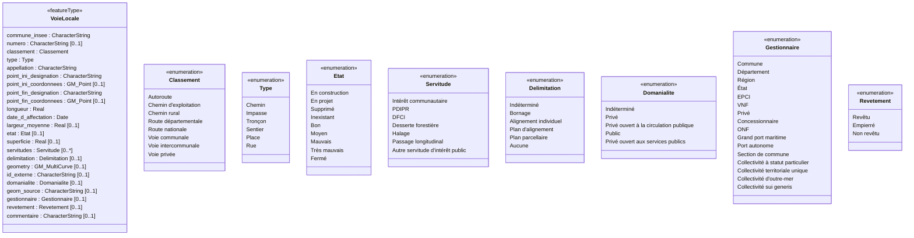

# Modèle conceptuel

Diagramme de classes UML des données décrites par [schema.json](schema.json). Il est écrit en [Mermaid](https://mermaid.js.org/syntax/classDiagram.html), que GitHub affiche sous forme de diagramme. La vérification automatique contrôle qu'il concorde avec schema.json : mêmes attributs, dans le même ordre, mêmes types, mêmes multiplicités et mêmes listes de valeurs.

## Diagramme

## Lecture du diagramme

Une instance de la classe `VoieLocale` (stéréotype `«featureType»`, objet géographique) correspond à une ligne du fichier CSV : une voie ou un tronçon de voie. Chaque attribut correspond à une colonne, et chaque liste de valeurs du schéma à une énumération (stéréotype `«enumeration»`).

| Multiplicité | Signification |
| --- | --- |
| *(aucune)* | Champ obligatoire dans le schéma : en UML, l'absence de multiplicité vaut exactement 1. |
| `[0..1]` | Champ facultatif dans le schéma. |
| `[0..*]` | Liste de valeurs, facultative (`servitudes`). |

| Type dans schema.json | Type UML | Norme |
| --- | --- | --- |
| `string` | `CharacterString` | ISO 19103 |
| `number` | `Real` | ISO 19103 |
| `date` | `Date` | ISO 19103 |
| `geopoint` | `GM_Point` | ISO 19107 |
| `geojson` (`LineString` ou `MultiLineString`) | `GM_MultiCurve` | ISO 19107 |
| `string` ou `array` avec liste de valeurs | énumération (`<<enumeration>>`) | |

## Contraintes hors diagramme

Ces règles, contrôlées par le script [controles_complementaires.py](controles_complementaires.py), rendent obligatoires des attributs facultatifs dans le diagramme :

- `numero` est obligatoire si `classement` vaut `Voie communale` ou `Chemin rural` ;
- `largeur_moyenne` est obligatoire si `classement` vaut `Voie communale` ;
- `etat` est obligatoire si `classement` vaut `Chemin rural` ;
- `point_ini_coordonnees` et `point_fin_coordonnees` sont obligatoires si `geometry` est renseignée.

Les autres règles (motifs, minimums, cohérence du numéro et du classement, géométrie, servitudes non répétées) sont décrites dans [schema.json](schema.json) et [CONTROLES.md](CONTROLES.md).

## Catalogue d'objets

| | |
| --- | --- |
| **Classe d'objet** | `VoieLocale` |
| **Définition** | |
| **Modélisation géométrique** | `GM_MultiCurve`, attribut `geometry`, facultatif |

<!-- début du catalogue : généré par .github/workflows/catalogue.py, ne pas modifier à la main -->

### Attributs de la classe VoieLocale

| Attribut | Définition | Occurrences | Type | Contraintes | Exemples |
| --- | --- | --- | --- | --- | --- |
| `commune_insee` | Code INSEE de la commune sur laquelle s'applique le recensement : 5 caractères, avec le zéro initial conservé (01001) et 2A ou 2B pour la Corse. Le motif vérifie la forme du code et l'existence du département, pas celle de la commune. | 1 | `CharacterString` | valeur obligatoire motif : `^((0[1-9]\|1\d\|2[1-9]\|[3-8]\d\|9[0-5])(00[1-9]\|0[1-9]\d\|[1-9]\d{2})\|(2A\|2B)(00[1-9]\|0[1-9]\d\|[1-9]\d{2})\|97[1-8]\d{2}\|98(4\|[6-9])\d{2})$` | `35095` |
| `numero` | Numéro de la voie (circulaire du 31 juillet 1961 et arrêté du 16 février 2023) : préfixe de 1 à 3 lettres (par exemple VC, CR, RD, N, A), espace facultatif, numéro, puis suffixe alphabétique facultatif, éventuellement précédé d'un espace (par exemple VC 12, CR1, C12bis, R 14E, RD 26). Pour une voie communale le préfixe doit être C ou VC, pour un chemin rural R ou CR : cette cohérence avec le classement n'est pas vérifiable par Table Schema, elle est contrôlée par le script controles_complementaires.py. Obligatoire pour une voie communale et pour un chemin rural, facultatif pour les autres classements : le schéma l'accepte vide, la règle n'est pas vérifiable par Table Schema et est contrôlée par le script. | 0..1 | `CharacterString` | valeur vide autorisée motif : `^[A-Za-z]{1,3}\s?\d+(\s?[A-Za-z]+)?$` | `VC 12` |
| `classement` | Classement administratif ou affectation de la voie. | 1 | `Classement` | valeur obligatoire liste de valeurs : [Classement](#classement) | `Voie communale` |
| `type` | Permet de classer une voie suivant ses caractéristiques. La valeur Tronçon est prévue par l'arrêté du 16 février 2023, qui ne la définit pas. | 1 | `Type` | valeur obligatoire liste de valeurs : [Type](#type) | `Chemin` |
| `appellation` | Appellation par les noms des lieux ou des voies publiques que la voie réunit (circulaire du 31 juillet 1961). | 1 | `CharacterString` | valeur obligatoire | `Chemin rural de derrière les jardins de Flandre` |
| `point_ini_designation` | Désignation du point où commence la voie. | 1 | `CharacterString` | valeur obligatoire | `Croisement entre la RD26 et la rue des genevriers` |
| `point_ini_coordonnees` | Coordonnées du point où commence la voie, en WGS 84, au format « longitude, latitude » du type geopoint de Table Schema, avec le point comme séparateur décimal et 6 décimales au maximum. La valeur contient une virgule et doit donc être entourée de guillemets doubles dans le fichier CSV. Obligatoire si la voie est représentée graphiquement (arrêté du 16 février 2023). | 0..1 | `GM_Point` | valeur vide autorisée | `5.466656, 45.445213` |
| `point_fin_designation` | Désignation du point où finit la voie. | 1 | `CharacterString` | valeur obligatoire | `Limite de commune avec Brunisseau-les-Bois` |
| `point_fin_coordonnees` | Coordonnées du point où finit la voie, en WGS 84, au format « longitude, latitude » du type geopoint de Table Schema, avec le point comme séparateur décimal et 6 décimales au maximum. La valeur contient une virgule et doit donc être entourée de guillemets doubles dans le fichier CSV. Obligatoire si la voie est représentée graphiquement (arrêté du 16 février 2023). | 0..1 | `GM_Point` | valeur vide autorisée | `5.471959, 45.450308` |
| `longueur` | Longueur en mètres de la voie (ou du tronçon la constituant) sur le territoire de la commune. Au moins 1 mètre. | 1 | `Real` | valeur obligatoire minimum : 1 | `701.5` |
| `date_d_affectation` | Date de création ou de mise à jour de l'acte (ou du tableau de recensement), au format AAAA-MM-JJ. | 1 | `Date` | valeur obligatoire | `1988-05-12` |
| `largeur_moyenne` | Largeur moyenne en mètres de la voie (ou du tronçon la constituant) sur le territoire de la commune. Strictement positive : au moins 0,1 mètre. Obligatoire pour une voie communale (circulaire du 31 juillet 1961), facultative pour les autres classements : le schéma l'accepte vide, la règle pour les voies communales n'est pas vérifiable par Table Schema et est contrôlée par le script controles_complementaires.py. | 0..1 | `Real` | valeur vide autorisée minimum : 0.1 | `3.5` |
| `etat` | État d'entretien et de conservation de la voie (ou du tronçon la constituant). Obligatoire pour un chemin rural (arrêté du 16 février 2023), facultatif pour les autres classements : le schéma l'accepte vide, la règle pour les chemins ruraux n'est pas vérifiable par Table Schema et est contrôlée par le script controles_complementaires.py. | 0..1 | `Etat` | valeur vide autorisée liste de valeurs : [Etat](#etat) | `Bon` |
| `superficie` | Superficie estimée ou calculée de la voie, en mètres carrés. Au moins 1 mètre carré. | 0..1 | `Real` | valeur vide autorisée minimum : 1 | `2455.25` |
| `servitudes` | Liste (au format JSON) des servitudes grevant la voie, des attributions supplémentaires ou des inscriptions de la voie à des schémas ou plans nationaux ou locaux. Chaque valeur doit appartenir à la liste autorisée et ne doit pas être répétée (cette dernière règle n'est pas vérifiable par Table Schema, elle est contrôlée par le script controles_complementaires.py). | 0..* | `Servitude` | valeur vide autorisée liste de valeurs : [Servitude](#servitude) | `["PDIPR","DFCI"]` |
| `delimitation` | Existence d'une détermination de la délimitation (bornage, alignement) de la voie (ou du tronçon la constituant). | 0..1 | `Delimitation` | valeur vide autorisée liste de valeurs : [Delimitation](#delimitation) | `Bornage` |
| `geometry` | Géométrie de la voie (ou du tronçon la constituant), au format GeoJSON de type LineString ou MultiLineString, en WGS 84 (coordonnées [longitude, latitude]). Facultative : laisser vide en l'absence de géométrie. Le type de géométrie et le système de coordonnées ne sont pas vérifiés par Table Schema, ils sont contrôlés par le script controles_complementaires.py. | 0..1 | `GM_MultiCurve` | valeur vide autorisée | `{"type":"LineString","coordinates":[[5.466656,45.445213],[5.471959,45.450308]]}` |
| `id_externe` | Identifiant de la voie (ou du tronçon la constituant) dans le référentiel indiqué par le champ geom_source (par exemple BD TOPO IGN, OSM, BAN, base locale). Le référentiel de l'identifiant et celui de la géométrie sont supposés identiques ; une voie sans géométrie n'a pas de référentiel déclaré. | 0..1 | `CharacterString` | valeur vide autorisée | `TRONROUT0000000123456789` |
| `domanialite` | Domanialité indicative de la voie (ou du tronçon la constituant). | 0..1 | `Domanialite` | valeur vide autorisée liste de valeurs : [Domanialite](#domanialite) | `Public` |
| `geom_source` | Source de la donnée depuis laquelle la géométrie a été extraite, référentiel géographique utilisé. C'est aussi le référentiel de l'identifiant externe (champ id_externe). | 0..1 | `CharacterString` | valeur vide autorisée | `BD TOPO` |
| `gestionnaire` | Gestionnaire de la voie (ou du tronçon la constituant). | 0..1 | `Gestionnaire` | valeur vide autorisée liste de valeurs : [Gestionnaire](#gestionnaire) | `Commune` |
| `revetement` | Revêtement de la voie (ou du tronçon la constituant). | 0..1 | `Revetement` | valeur vide autorisée liste de valeurs : [Revetement](#revetement) | `Revêtu` |
| `commentaire` | Commentaire, remarque ou précision éventuelle au sujet de la voie. | 0..1 | `CharacterString` | valeur vide autorisée | `Voie d'accès public à la parcelle 405` |

### Types énumérés

Les définitions, regroupements et références juridiques sont repris du [modèle tableur](https://fichiers.numerique.gouv.fr/wopi/cdf35f2b-302f-49d0-99e1-e4b38f483f68), un onglet par liste.

#### Classement

Attribut `classement`, onglet `classement` du modèle tableur.

| Valeur | Définition | Regroupement | Juridique |
| --- | --- | --- | --- |
| Autoroute | Route sans croisement, accessible seulement en des points aménagés à cet effet et réservée aux véhicules à propulsion mécanique | Autoroute \|Quasi-autoroute | https://www.legifrance.gouv.fr/codes/article_lc/LEGIARTI000039786386 |
| Chemin d'exploitation | Voie servant exclusivement à la communication entre divers fonds, ou à leur exploitation, présumée appartenant aux propriétaires riverains | Chemin d'exploitation \| Sentier d'exploitation | https://www.legifrance.gouv.fr/codes/article_lc/LEGIARTI000006582187 |
| Chemin rural | Voie appartenant au domaine privé de la commune, affecté à la circulation publique |  | https://www.legifrance.gouv.fr/codes/article_lc/LEGIARTI000039786386 |
| Route départementale | Voie faisant partie du domaine public routier départemental | Route départementale \| Chemins de la Collectivité territoriale | https://www.legifrance.gouv.fr/codes/article_lc/LEGIARTI000039786386 |
| Route nationale | Voie faisant partie du domaine public routier national autre que les autoroutes | Route nationale \| Route territoriale de la collectivité de Corse | https://www.legifrance.gouv.fr/codes/article_lc/LEGIARTI000039786386 |
| Voie communale | Voie faisant partie du domaine public routier communal |  | https://www.legifrance.gouv.fr/codes/article_lc/LEGIARTI000039786386 |
| Voie intercommunale | Voie numérotée faisant partie du domaine public d'un EPCI | Voie communautaire \| Route métropolitaine \| Route intercommunale | https://www.legifrance.gouv.fr/jorf/article_jo/JORFARTI000023239670 |
| Voie privée | Autre voie du domaine privé | Voie privée urbaine \| Lotissement privé \| Chemin de culture \| Chemin d'aisance \| Chemin de servitude \| Chemin de vidange \| Chemin de terre |  |

#### Type

Attribut `type`, onglet `type` du modèle tableur.

| Valeur | Définition |
| --- | --- |
| Chemin | « prévu pour la circulation de véhicules ou d’engins d’exploitation, ne sont pas forcément carrossables pour tous les véhicules et par tous les temps » (BD TOPO) |
| Impasse |  |
| Tronçon |  |
| Sentier | « Voie étroite ne permettant pas le passage de véhicules automobiles et de largeur inférieure à 2 m. Un sentier peut être revêtu ou non. » (BD TOPO) |
| Place |  |
| Rue | voies « désignées par des noms et situées à l'intérieur de l'agglomération » (Circulaire du 31 juillet 1961). |

#### Etat

Attribut `etat`, onglet `etat` du modèle tableur.

| Valeur | Définition | Regroupement |
| --- | --- | --- |
| En construction | En cours de création, de réhabilitation, de réfection | En construction \| En travaux |
| En projet |  |  |
| Supprimé | N'existe plus | Annexé \| Accaparé \| Approprié |
| Inexistant | N'existe plus (date inconnue) | Disparu \| N'a jamais existé à cet endroit |
| Bon | Praticable et entretenu régulièrement (fauchage, passage, etc.) |  |
| Moyen | Praticable et entretenu irrégulièrement (fauchage, passage, etc.) |  |
| Mauvais | Praticable mais non entretenu |  |
| Très mauvais | Non praticable mais visible | Bouché par la végétation \| Détériorié par le passage d'engins \| Obstacles importants \| Raviné |
| Fermé | Volontairement entravé (barrière, chaîne, corde, barbelés, etc.) |  |

#### Servitude

Attribut `servitudes`, onglet `servitudes` du modèle tableur.

| Valeur | Définition | Regroupement | Juridique |
| --- | --- | --- | --- |
| Intérêt communautaire | La voie est déclarée d'intérêt communautaire | Voie d'intérêt communautaire | https://www.legifrance.gouv.fr/codes/article_lc/LEGIARTI000051459827 |
| PDIPR | La voie est inscrite au Plan Départemental des Itinéraires de Promenade et de Randonnée (PDIPR) |  | https://www.legifrance.gouv.fr/codes/article_lc/LEGIARTI000045212099 |
| DFCI | La voie fait partie des voies de défense des bois et forêts contre l'incendie |  | https://www.legifrance.gouv.fr/codes/section_lc/LEGITEXT000025244092/LEGISCTA000047811305 |
| Desserte forestière | La voie est inscrite au schéma d'accès à la ressource forestière et/ou utilisée pour l'exploitation des forêts | Route forestière \| Chemin forestier \| Piste forestière \| Voie forestière | https://www.legifrance.gouv.fr/codes/id/LEGISCTA000029586862 |
| Halage | Voie issue de la servitude de halage (7,8m) le long des bords des cours d'eau domaniaux | Halage \|Marchepieds | https://www.legifrance.gouv.fr/codes/article_lc/LEGIARTI000031065981 |
| Passage longitudinal | Voie issue de la servitude de passage longitudinale (3m) le long des propriétés privées riveraines du domaine public maritime |  | https://www.legifrance.gouv.fr/codes/article_lc/LEGIARTI000031210502 |
| Autre servitude d'intérêt public | À compléter. | Canalisation \| Drainage \| Irrigation \| Ligne électrique \| Gazoduc \| Protection de captage \| Télécommunications |  |

#### Delimitation

Attribut `delimitation`, onglet `delimitation` du modèle tableur.

| Valeur | Définition | Juridique |
| --- | --- | --- |
| Indéterminé |  |  |
| Bornage | La voie est concernée par un bornage (complet ou partiel) | https://www.legifrance.gouv.fr/codes/article_lc/LEGIARTI000006587655 |
| Alignement individuel | La voie est concernée par un alignement fixé par un alignement individuel | https://www.legifrance.gouv.fr/codes/article_lc/LEGIARTI000031373525 |
| Plan d'alignement | La voie est concernée par un alignement fixé par un plan d'alignement | https://www.legifrance.gouv.fr/codes/article_lc/LEGIARTI000031373525 |
| Plan parcellaire | La voie est délimitée par le plan parcellaire annexé à la délibération du conseil municipal portant ouverture ou modification des emprises du chemin rural | https://www.legifrance.gouv.fr/codes/article_lc/LEGIARTI000006587655 |
| Aucune |  |  |

#### Domanialite

Attribut `domanialite`, onglet `domanialite` du modèle tableur.

| Valeur | Définition | Regroupement |
| --- | --- | --- |
| Indéterminé | On sait qu'on ne sait pas. |  |
| Privé |  |  |
| Privé ouvert à la circulation publique | Voie ne faisant pas partie du domaine public et dont l'accès est autorisé sans restriction | Chemin rural \| Voirie de lotissement privé |
| Public | Voie faisant partie du domaine public |  |
| Privé ouvert aux services publics |  |  |

#### Gestionnaire

Attribut `gestionnaire`, onglet `gestionnaire` du modèle tableur.

| Valeur | Définition | Juridique |
| --- | --- | --- |
| Commune | Collectivité territoriale de base, la plus petite division administrative française. |  |
| Département | Collectivité territoriale investie d'une mission d'intérêt général concernant le département. |  |
| Région |  |  |
| État |  |  |
| EPCI |  |  |
| VNF |  |  |
| Privé |  |  |
| Concessionnaire |  |  |
| ONF |  |  |
| Grand port maritime | Établissement public de l'État chargé de la gestion d'un port maritime. | https://www.legifrance.gouv.fr/codes/article_lc/LEGIARTI000043516066 |
| Port autonome | Établissement public de l'État chargé de la gestion d'un port autonome. |  |
| Section de commune |  | https://www.legifrance.gouv.fr/codes/id/LEGISCTA000006164586 |
| Collectivité à statut particulier |  |  |
| Collectivité territoriale unique |  |  |
| Collectivité d'outre-mer |  |  |
| Collectivité sui generis |  |  |

#### Revetement

Attribut `revetement`, onglet `revetement` du modèle tableur.

| Valeur | Définition | Regroupement |
| --- | --- | --- |
| Revêtu |  | Bitumé \| Goudronné \| Asphalté \| Macadamé \| Betonné \| Cimenté |
| Empierré | Route sommairement revêtue (pas de revêtement de surface ou revêtement très dégradé), mais permettant la circulation de véhicules automobiles de tourisme par tous les temps. (BD TOPO) | Empierré \| Pavé \| Gravillonné \| Dallé \| En graviers \| Carrelé |
| Non revêtu |  | Enherbé \| Terrain naturel |

<!-- fin du catalogue -->

## Maintenance

Toute modification de schema.json est reportée dans ce diagramme. Le script [assert_modele.py](.github/workflows/assert_modele.py) signale tout écart entre les deux.

Le catalogue d'objets est produit à partir de schema.json, du diagramme et du [modèle tableur](https://fichiers.numerique.gouv.fr/wopi/cdf35f2b-302f-49d0-99e1-e4b38f483f68) par le script [catalogue.py](.github/workflows/catalogue.py) : `python .github/workflows/catalogue.py --ecrire` le réécrit. Le même script, sans option, signale un catalogue qui n'est plus à jour, ou une liste de valeurs différente entre le tableur et schema.json.
